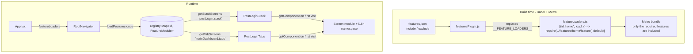

# Feature System

This document explains how features are plugged into HamidApp: how they are
chosen at build time, how their code and translations are loaded lazily at
runtime, and how the Babel plugin, the registry and the navigators fit
together.

It covers the following files:

| File | Role |
| --- | --- |
| [`src/registry/features.json`](../src/registry/features.json) | Build-time list of the features to bundle (`include` / `exclude`). |
| [`babel/featuresPlugin.js`](../babel/featuresPlugin.js) | Babel plugin that turns `features.json` into code. |
| [`babel.config.js`](../babel.config.js) | Registers the plugin, along with the `@…` path aliases. |
| [`src/registry/featureLoaders.ts`](../src/registry/featureLoaders.ts) | The one place where the plugin's output is injected (`__FEATURE_LOADERS__`). |
| [`src/registry/featureTypes.ts`](../src/registry/featureTypes.ts) | The manifest contract (`FeatureModule`, `FeatureScreen`, `FeatureLoader`). |
| [`src/registry/registry.ts`](../src/registry/registry.ts) | Runtime registry: evaluates manifests, wraps lazy i18n, serves screens to navigators. |
| [`src/navigation/navigators.ts`](../src/navigation/navigators.ts) | Declares navigator ids that screens can attach to. |
| [`src/navigation/RootNavigator.tsx`](../src/navigation/RootNavigator.tsx), [`PostLoginStack.tsx`](../src/navigation/PostLoginStack.tsx), [`PostLoginTabs.tsx`](../src/navigation/PostLoginTabs.tsx) | Navigators that read screens from the registry. |
| [`src/features/home/feature.ts`](../src/features/home/feature.ts) | The reference feature manifest (the only migrated feature so far). |

---

## The big picture



There are three stages, and each one does as little work as it can:

1. **Build time.** The plugin reads `features.json` and writes one static
   `require` per selected feature. Metro only bundles modules it can reach
   through a static `require`, so features that are not selected are left out
   of the bundle entirely (but see the caveats about unmigrated features
   below).
2. **App start / first render.** Each selected feature's *manifest*
   (`feature.ts`) is evaluated once, so the app knows which screens exist and
   where they go. The screens themselves are not evaluated yet.
3. **First visit to a screen.** React Navigation calls the screen's
   `getComponent`. That is when the feature's translations are registered and
   the screen module is required.

---

## 1. Including and excluding features at build time

### `features.json`

```json
{
  "include": ["./src/features/home/feature"],
  "exclude": []
}
```

Rules, as enforced by `readConfig`, `resolveEntry` and `selectFeatures` in
[`babel/featuresPlugin.js`](../babel/featuresPlugin.js):

- **Only two keys are allowed:** `include` and `exclude`. Any other key fails
  the build (`features.json: unknown key "..."`). Both are optional and default
  to `[]`. Each must be an array of strings.
- **Every entry is an explicit path** to the feature's manifest, relative to
  the project root. The extension is optional; the plugin tries the bare path,
  then `.ts`, `.tsx`, `.js` and `.jsx`.
- **Wildcards are rejected.** An entry that contains `*` fails the build. Each
  feature must be listed by name.
- **Unresolvable paths fail the build, in either list.** A typo in `exclude`
  is an error, not a silent no-op. This also means you cannot exclude a
  feature whose folder has been deleted. Remove the entry instead.
- **Selection is `include − exclude`.** Entries are compared after they are
  resolved to absolute, extension-less paths, so `./src/features/home/feature`
  and `./src/features/home/feature.ts` count as the same feature. Duplicates
  in `include` are dropped.
- **Order does not matter.** The plugin keeps the `include` order, but tab
  order comes from `tab.index` in each manifest (see section 3), not from
  `features.json`.

#### Why have `exclude` at all?

`include` is the list of every feature the app has. `exclude` lets a
particular build switch features off (for example, a white-label variant or a
feature-flagged release) without editing the canonical list. Because exclusion
happens at build time, an excluded feature's code is never put into the
bundle, unlike a runtime flag that ships the code and hides it.

### Feature ids

A feature's **id is the name of the folder that contains its manifest**:

```
./src/features/home/feature   →  id "home"
```

The id is used as:

- the registry key (`Map<id, FeatureModule>`), and
- the feature's **i18n namespace** (section 2).

Two selected features with the same folder name fail the build
(`features.json: two features share the id "..."`).

### What the plugin emits

The plugin looks for the free global identifier `__FEATURE_LOADERS__`, which
is used only in [`src/registry/featureLoaders.ts`](../src/registry/featureLoaders.ts):

```ts
declare const __FEATURE_LOADERS__: FeatureLoader[];
export const featureLoaders: FeatureLoader[] = __FEATURE_LOADERS__;
```

and replaces it with an array literal. With the current `features.json`,
the file is compiled to:

```js
export const featureLoaders = [
  {id: 'home', load: () => require('../features/home/feature').default},
];
```

Some details:

- The `require` path is **relative to the file being transformed**
  (`state.filename`), with forward slashes and a leading `./` or `../`, so
  Metro resolves it like any hand-written import.
- The identifier is only replaced when it is a *referenced* identifier with
  *no local binding* (`scope.hasBinding` is false). A local variable or
  property that happens to be named `__FEATURE_LOADERS__` is left alone. The
  `declare const` in TypeScript is erased before this check matters, so it
  only exists to keep the type checker happy.
- The `require` argument is a **string literal**, which is what lets Metro's
  static dependency graph see it. A computed path such as
  `require(base + id)` would not be bundled.

### Build-time caveats

- **Restart Metro with `--reset-cache` after editing `features.json`.** Metro
  caches each file's transform by its own contents. `featureLoaders.ts` does
  not change when `features.json` does, so Metro keeps serving the old array
  until the cache is reset:

  ```sh
  npm start -- --reset-cache
  ```

- **Jest goes through the same plugin.** Jest uses `babel.config.js`, so tests
  that import `featureLoaders.ts` see the same feature list as the app.
- **Excluding a feature only removes what the registry would have reached.**
  If some other file imports or requires the feature directly, Metro still
  bundles it. That is the case today for the unmigrated features
  (section 4): `about`, `skills`, `experience` and `contact` are hard-coded in
  `PostLoginTabs.tsx`, and their translations are imported eagerly in
  `src/i18n/index.ts`. Adding them to `exclude` has no effect until they are
  migrated to manifests.
- **Cross-feature navigation is by route name and is not checked.**
  `HomeScreen` calls `navigation.navigate('About')`. If the feature that owns
  `About` were excluded, the call would fail at runtime (React Navigation logs
  a "not handled by any navigator" warning). Guard cross-feature links, or
  keep the features that depend on each other together.

---

## 2. Lazy loading: screens and translations

"Lazy" here means **lazy evaluation**, not lazy download. Every selected
feature is in the single JS bundle. What is deferred is *running* its module
code: the screen component, its imports, and the JSON translation objects.
That keeps startup work proportional to what the user actually opens.

There are three levels of laziness.

### Level 1: the manifest (`load`)

Each loader is `() => require('…/feature').default`. Because the `require`
sits inside a function, the manifest module is not evaluated when
`featureLoaders.ts` is imported. It is evaluated when the registry calls
`load()`.

`RootNavigator` does that once, on its first render:

```tsx
// src/navigation/RootNavigator.tsx
useMemo(() => loadFeatures(featureLoaders), [featureLoaders]);
```

`loadFeatures` calls every `load()` and stores the result under its id:

```ts
// src/registry/registry.ts
export function loadFeatures(loaders: FeatureLoader[]): void {
  loaders.forEach(({id, load}) => {
    registry.set(id, withLazyLoad(id, load()));
  });
}
```

It is idempotent per id: calling it again overwrites the entry with an
equivalent one. A manifest should therefore be cheap and free of side
effects. It is plain data plus functions.

### Level 2: the screen component (`getComponent`)

A manifest never imports its screens at the top level. Each screen is
described with a `getComponent` thunk:

```ts
// src/features/home/feature.ts
{
  name: 'Home',
  navigator: 'mainDashboard.tabs',
  tab: {index: 0, icon: 'home', labelKey: 'nav.home'},
  getComponent: () => require('./HomeScreen').default,
},
```

The navigators pass `getComponent` straight to React Navigation's
`<Screen getComponent={…} />` prop. React Navigation calls it only when the
screen is first rendered. For a tab, that is when the tab is focused (bottom
tabs are lazy by default). For a stack screen, it is when the screen is pushed.
Until then, `HomeScreen.tsx` and everything it imports are not executed. You
can see this with the `console.log('HomeScreen evaluated')` at the top of
`HomeScreen.tsx`.

> **Rule:** do not `import` screen modules at the top of `feature.ts`. A
> static import evaluates the screen as soon as the manifest is loaded, which
> undoes level 2.

### Level 3: translations (`i18n`)

A manifest can declare its translations the same lazy way:

```ts
i18n: () => require('./i18n').default,
```

where `./i18n/index.ts` returns one bundle per language:

```ts
import en from './en.json';
import ar from './ar.json';
export default {en, ar};          // I18nBundles = Record<lang, object>
```

The registry does not load these when the manifest is loaded. Instead,
`withLazyLoad` **wraps every screen's `getComponent`** so that the namespace is
registered just before the first screen of that feature is required:

```ts
// src/registry/registry.ts
const ensureNamespace = () => {
  if (!registeredNamespaces.has(id)) {
    Object.entries(i18n()).forEach(([lng, resources]) => {
      i18next.addResourceBundle(lng, id, resources, true, true);
    });
    registeredNamespaces.add(id);
  }
};
// …
getComponent: () => {
  ensureNamespace();
  return screen.getComponent();
},
```

What this guarantees:

- **The namespace is the feature id.** Translations from
  `src/features/home/i18n` are registered as the `home` namespace, so screens
  read them with `useTranslation('home')`, as `HomeScreen` and
  `ShowcaseScreen` do.
- **It is registered before the component exists.** `ensureNamespace()` runs
  synchronously before `screen.getComponent()`, so by the time the component
  first calls `t(...)` its keys are already in the store. There is no flash of
  raw keys and no need for Suspense.
- **It is registered once per feature, not per screen.** `registeredNamespaces`
  makes later calls no-ops, whichever of the feature's screens is opened first
  (Home or Showcase).
- **All languages are registered together.** Every language in the bundle
  (`en`, `ar`) is added, so switching language later finds the namespace
  already there.
- **`addResourceBundle(lng, ns, resources, deep = true, overwrite = true)`**
  merges deeply and lets the feature's values win if the namespace already
  exists.

#### What stays in the shared (`common`) namespace

Some strings are needed **before** any screen of the feature is opened: the
tab bar label and the stack header title. These are resolved by the
navigators with the default namespace (`useTranslation()` → `common`), so they
must live in [`src/shared/i18n`](../src/shared/i18n), not in the feature's own
bundle:

| Manifest field | Resolved by | Namespace | Example |
| --- | --- | --- | --- |
| `tab.labelKey` | `PostLoginTabs` | `common` | `nav.home` |
| `titleKey` | `PostLoginStack` | `common` | `nav.showcase` |
| Anything inside the screen | the screen | feature id | `home:hero.heading` |

#### How the global i18n setup fits in

[`src/i18n/index.ts`](../src/i18n/index.ts) is imported first in `App.tsx`. It
initializes i18next with `defaultNS: 'common'`, `fallbackLng: 'en'`, and the
language taken from the native RTL flag. It also **eagerly** includes the
translations of the unmigrated features (`login`, `about`, `skills`,
`experience`, `contact`). Migrated features must *not* be added there. Their
translations arrive through the registry. When a feature is migrated, remove
its import from this file.

---

## 3. The Babel plugin, the registry and navigation

### The manifest contract

From [`src/registry/featureTypes.ts`](../src/registry/featureTypes.ts):

```ts
type FeatureModule = {
  i18n?: () => I18nBundles;       // lazy translations, namespace = feature id
  screens: FeatureScreen[];
};

type FeatureScreen = TabScreen | StackScreen;

type TabScreen = {
  name: string;                   // route name, must be unique app-wide
  navigator: TabNavigatorId;      // e.g. 'mainDashboard.tabs'
  tab: {index: number; icon: string; labelKey: string};
  getComponent: () => React.ComponentType<any>;
};

type StackScreen = {
  name: string;
  navigator: StackNavigatorId;    // e.g. 'postLogin.stack'
  titleKey?: string;              // header title key (common ns); defaults to name
  getComponent: () => React.ComponentType<any>;
};
```

The union is discriminated by `navigator`. TypeScript requires `tab` for tab
navigators and forbids it for stacks (`tab?: never`). It also forbids
`titleKey` on tab screens.

### Navigator ids

[`src/navigation/navigators.ts`](../src/navigation/navigators.ts) is the single
declaration of the navigation tree:

```ts
export const navigators = {
  'preLogin.stack':          {type: 'stack', initial: 'Login', headerShown: false},
  'postLogin.stack':         {type: 'stack', initial: 'MainDashboard'},
  'mainDashboard.tabs':      {type: 'tab', mountedIn: 'postLogin.stack', as: 'MainDashboard'},
  'secondaryDashboard.tabs': {type: 'tab', mountedIn: 'postLogin.stack', as: 'SecondaryDashboard'},
} as const;
```

Only the **ids and `type`** are read today. They produce the
`TabNavigatorId` and `StackNavigatorId` types, so a manifest cannot attach a
screen to a navigator that does not exist, or put a tab screen on a stack.
`initial`, `headerShown`, `mountedIn` and `as` describe the intended
structure but are not yet used by any code.

### The registry API

[`src/registry/registry.ts`](../src/registry/registry.ts) keeps a module-level
`Map<id, FeatureModule>` and exposes:

| Function | Used by | Behaviour |
| --- | --- | --- |
| `loadFeatures(loaders)` | `RootNavigator` | Calls each `load()`, wraps it with lazy i18n, stores it by id. |
| `getTabScreens(navigatorId)` | `PostLoginTabs` | All tab screens for that navigator across all features, **sorted by `tab.index`**. Throws if two share an index. |
| `getStackScreens(navigatorId)` | `PostLoginStack` | All stack screens for that navigator, in feature-registration order. |
| `resetRegistry()` | tests | Clears the registry and the registered-namespace set. |

The registry knows nothing about React Navigation. It only answers the
question "which screens belong to navigator X?" Each navigator component is
responsible for rendering them.

### How the navigators use it

**`PostLoginStack`** (navigator id `postLogin.stack`) renders a fixed `Tabs`
screen (the tab navigator), then every registered stack screen on top of it:

```tsx
const pushedScreens = getStackScreens('postLogin.stack');
// …
<Stack.Screen name="Tabs" component={PostLoginTabs} options={{headerShown: false}} />
{pushedScreens.map(screen => (
  <Stack.Screen
    key={screen.name}
    name={screen.name}
    getComponent={screen.getComponent}          // wrapped by withLazyLoad
    options={{title: screen.titleKey ? t(screen.titleKey) : screen.name}}
  />
))}
```

Any screen can then call `navigation.navigate('Showcase')`. Because the stack
is the parent of the tabs, the navigate call bubbles up from a tab screen to
the stack that owns `Showcase`.

**`PostLoginTabs`** (navigator id `mainDashboard.tabs`) renders the
registry's tab screens first, then the unmigrated tabs that are still
hard-coded. Icon and label come from `tab.icon` and `tab.labelKey` for
registry screens, and from the local `TAB_ICONS` / `TAB_LABEL_KEYS` maps for
the others:

```tsx
const featureTabs = getTabScreens('mainDashboard.tabs');
// screenOptions: label = t(featureTab?.labelKey ?? TAB_LABEL_KEYS[route]),
//                icon  = featureTab?.icon ?? TAB_ICONS[route]
{featureTabs.map(screen => (
  <Tab.Screen key={screen.name} name={screen.name} getComponent={screen.getComponent} />
))}
<Tab.Screen name="About" getComponent={() => require('../features/about/AboutScreen').default} />
…
```

So `tab.index` orders registry tabs among themselves, and all registry tabs
appear **before** the hard-coded ones. The icon name is an Ionicons base name.
The navigator adds the `-outline` suffix when the tab is not focused.

### End-to-end walkthrough: the `home` feature

1. **Build.** `features.json` includes `./src/features/home/feature`. The plugin
   resolves it to `src/features/home/feature.ts`, gives it id `home`, and
   compiles `featureLoaders.ts` to
   `[{id: 'home', load: () => require('../features/home/feature').default}]`.
   Metro bundles `feature.ts` and, through its thunks, `HomeScreen.tsx`,
   `ShowcaseScreen.tsx` and `i18n/*`.
2. **App start.** `App.tsx` initializes i18next (`common` plus the
   unmigrated namespaces) and renders `RootNavigator` with `featureLoaders`.
3. **First render.** `RootNavigator` calls `loadFeatures`. `feature.ts` is
   evaluated and stored as `home`. Its two `getComponent`s are wrapped.
   Neither screen nor its translations have run yet.
4. **Login.** `PostLoginStack` asks for `postLogin.stack` screens and gets
   `Showcase`, with header title `t('nav.showcase')` → "Impact".
   `PostLoginTabs` asks for `mainDashboard.tabs` and gets `Home` (index 0),
   labelled `t('nav.home')`.
5. **Home tab focused.** React Navigation calls the wrapped `getComponent`.
   `ensureNamespace()` adds `en.home` and `ar.home` to i18next, then
   `require('./HomeScreen')` runs (logging "HomeScreen evaluated"), and the
   screen renders with `useTranslation('home')`.
6. **User taps "See My Impact".** `navigate('Showcase')` bubbles to the
   stack. The wrapped `getComponent` runs, `ensureNamespace()` is a no-op this
   time, and `ShowcaseScreen` is required and rendered.

---

## 4. Current state and known gaps

- **Only `home` is migrated.** `about`, `skills`, `experience` and `contact`
  are still hard-coded tabs in `PostLoginTabs.tsx`, and their translations are
  loaded eagerly in `src/i18n/index.ts`. `login` is hard-coded in
  `PreLoginStack.tsx`.
- **Only two navigator ids are wired to the registry:** `postLogin.stack` and
  `mainDashboard.tabs`. A screen declared on `preLogin.stack` or
  `secondaryDashboard.tabs` type-checks but is **silently never rendered**,
  because no navigator calls `getStackScreens('preLogin.stack')` or
  `getTabScreens('secondaryDashboard.tabs')`. Wire the navigator before you
  target it.
- **Route names are global and unchecked.** Two features declaring the same
  `name` produce duplicate screens in React Navigation. Only duplicate
  `tab.index` values are detected.
- **The plugin's header comment overstates the role of `inlineRequires`.** It
  says deferral relies on Metro's `inlineRequires` option. In fact, deferral
  comes from the `require` being inside an arrow function, which works with or
  without that option.

---

## Recipes

### Migrate or add a feature

1. Create `src/features/<id>/feature.ts` that exports a `FeatureModule`
   by default. Use `getComponent: () => require('./XScreen').default` for each
   screen. Do not add top-level imports of screens.
2. Put the feature's own strings in `src/features/<id>/i18n/{en,ar}.json`, add
   an `index.ts` that exports `{en, ar}`, and set
   `i18n: () => require('./i18n').default`. In screens, use
   `useTranslation('<id>')`.
3. Put the tab label and header title keys in `src/shared/i18n/{en,ar}.json`
   under `nav.*`.
4. Pick a `tab.index` that no other screen on that navigator uses.
5. Add `./src/features/<id>/feature` to `include` in `features.json`.
6. If you are migrating an existing feature, remove its hard-coded
   `<Tab.Screen>` (and its `TAB_ICONS` / `TAB_LABEL_KEYS` entries) from
   `PostLoginTabs.tsx`, and remove its import from `src/i18n/index.ts`.
   Otherwise it is bundled and registered twice.
7. Restart Metro with `--reset-cache`.

### Exclude a feature from a build

Add its path to `exclude` (it must still resolve to a file) and restart Metro
with `--reset-cache`. Then check that no other feature navigates to its
routes, or guard those links.
